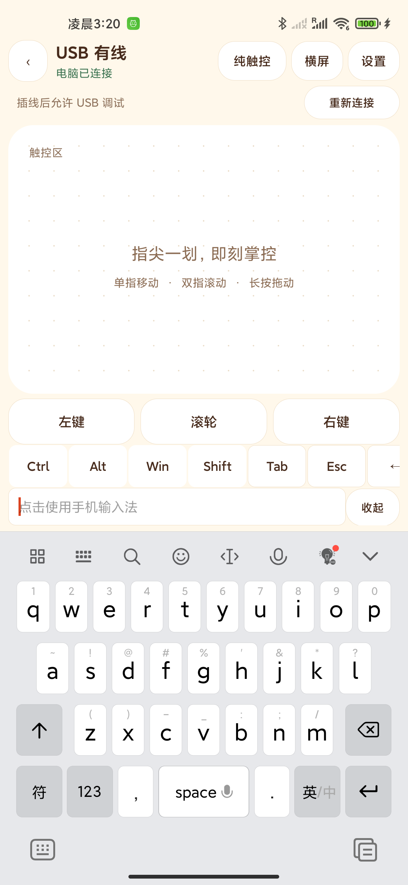

  
  <h1>MambaPad</h1>
  
<strong>Control at your fingertips.</strong>

  
Turn your Android phone into a touchpad and keyboard for Windows.

  
<a href="README.md">中文</a> · English

  
<a href="https://github.com/FFraankk/MambaPad/releases">Download</a> · <a href="#get-started">Get started</a> · <a href="https://github.com/FFraankk/MambaPad/issues">Report an issue</a>

---

Connect your phone to your PC over USB. Move the pointer, scroll pages, drag files, and type with your phone’s familiar keyboard. No root required. Choose a portable Windows app or an installer.

**Android 9+ · Windows 10 / 11 x64 · Current version: 1.3.2**

  
  
Your touchpad and phone keyboard, together in one view.

## Touch, type, and stay in control

- **A touchpad in your hand**: Tap, double-tap, drag, and scroll with two fingers. Dedicated left, right, and scroll buttons are also available.
- **Type with your favorite keyboard**: Over USB, send confirmed text from your phone’s input method, including Chinese, English, and emoji. A shortcut bar provides Ctrl, Alt, Win, Shift, arrow keys, and more.
- **Layouts that fit the task**: Use your system keyboard in portrait, a split keyboard with a central touchpad in landscape, or a touchpad-only layout. Tap **系统输入法** (System keyboard) in landscape to open your phone’s input method.
- **Copy and paste with one tap**: Both layouts provide buttons for Ctrl+C / Ctrl+V in the active PC application.
- **Feel each press**: System haptics respond to taps, mouse buttons, the start of a drag, and landscape keyboard presses. Turn them off in settings whenever you prefer.
- **Keep your desktop clear**: A native Windows window shows connection status and lets you select a device. Minimize or close it to keep the connection running in the system tray.
- **Install it or take it with you**: The installer adds a Start menu entry and supports uninstalling. The portable version runs after extraction. Neither requires a separate Java or .NET installation on your PC.

## Download

The current stable release is **1.3.2**. Install the Android APK on your phone and choose one Windows package for your PC.

| Download | Use it for |
| --- | --- |
| [Android APK](https://github.com/FFraankk/MambaPad/releases/download/v1.3.2/MambaPad-1.3.2.apk) | Installing on your Android phone |
| [Windows installer](https://github.com/FFraankk/MambaPad/releases/download/v1.3.2/MambaPad-Windows-x64-1.3.2-Setup.exe) | Installing on your PC with a Start menu entry |
| [Windows portable](https://github.com/FFraankk/MambaPad/releases/download/v1.3.2/MambaPad-Windows-x64-1.3.2-Portable.zip) | Running directly from an extracted folder |

Find all versions and file checksums on [Releases](https://github.com/FFraankk/MambaPad/releases). The APK remains a debug build with the existing debug signing certificate, allowing updates over earlier previews. The Windows executable and installer are not code-signed.

## Get started

1. Install the APK on your phone. On your PC, install the Windows app or fully extract the portable ZIP.
2. Start **MambaPad** on your PC and connect your phone with a USB cable that supports data transfer.
3. Enable **USB debugging** on your phone and approve debugging access for this PC. Some PCs may also need an ADB driver from the phone manufacturer.
4. Open MambaPad on your phone, choose **USB 有线** (USB wired), and wait for the connection.
5. Slide on the touchpad to move the pointer. Tap **键盘** (Keyboard) to switch input modes; in portrait, tap the input field to open your phone’s keyboard.

Keep the PC app running while you use MambaPad. Closing its window sends it to the system tray. Choose **退出** (Exit) from the window or tray menu to quit. Keep the portable version’s extracted folder structure intact.

## Everyday gestures

| Action | Gesture |
| --- | --- |
| Move the pointer | Slide with one finger |
| Click / double-click | Tap once / tap twice |
| Drag | Tap once, then quickly press again and slide; lift to release |
| Keep dragging at the touchpad edge | Keep holding to continue slowly in the same direction; lift, release Left, or slide inward to stop |
| Scroll | Slide with two fingers, or hold and drag the scroll button vertically |
| Open a context menu | Tap the right mouse button |

The shortcut bar above the portrait keyboard scrolls horizontally. Tap **收起** (Hide) to dismiss the phone keyboard. A brief gesture recognition delay distinguishes clicks, double-clicks, and dragging.

Three- and four-finger swipes trigger once all fingers lift. Three fingers: swipe left/right for the next/previous app, or up for Task View. Four fingers: swipe left/right for the next/previous virtual desktop, up for Task View, or down to show the desktop. The **桌面** (Desktop) button also shows/restores the desktop. Three-finger down is reserved for the phone system screenshot gesture. Two-finger tap opens the context menu; pinch sends Ctrl+wheel zoom where supported by the PC app.

## Before you use it

- The main supported setup is **USB + Windows**. Bluetooth HID mode is also available, with pairing and device compatibility still being improved. Chinese input over Bluetooth requires the PC’s input method.
- Use a matching Windows receiver version for USB text input.
- With normal Windows permissions, control of administrator windows, UAC prompts, and the sign-in screen is not guaranteed.
- Haptics depend on your phone’s hardware and system settings. Floating keyboard placement is controlled by the keyboard app itself.

## License and credits

MambaPad is based on [KeysJoy](https://github.com/iFeel-is-a-mouse/KeysJoy), which originated from Dima Rostopira’s [Kontroller](https://github.com/rostopira/kontroller). The project retains the Apache License 2.0 and upstream copyright and license notices. See [LICENSE](LICENSE) and [NOTICE.txt](NOTICE.txt).

Want to build it yourself? See the [build instructions](BUILDING.md) (Chinese).
