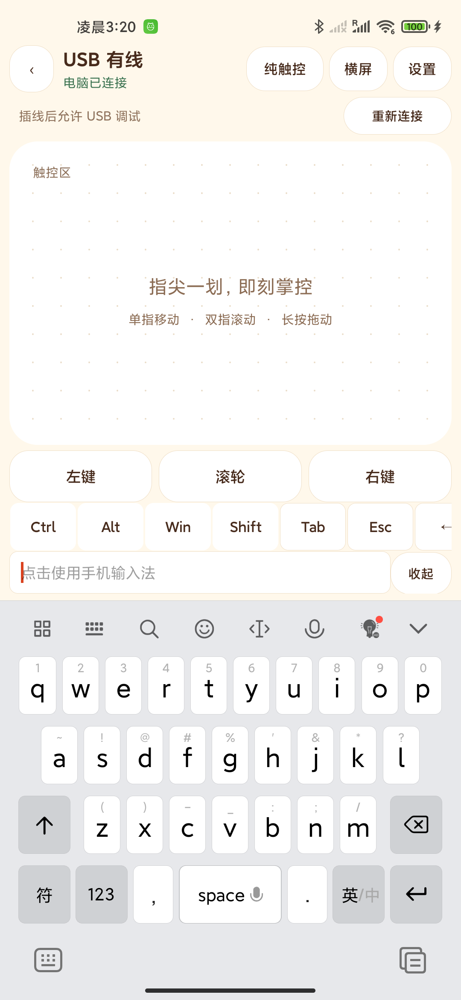

  
  <h1>MambaPad</h1>
  
<strong>指尖一划，即刻掌控。</strong>

  
把 Android 手机变成 Windows 电脑的触控板与键盘。

  
中文 · <a href="README.en.md">English</a>

  
<a href="https://github.com/FFraankk/MambaPad/releases">下载应用</a> · <a href="#快速开始">快速开始</a> · <a href="https://github.com/FFraankk/MambaPad/issues">反馈问题</a>

---

MambaPad 通过 USB 连接手机与电脑，让你用熟悉的触摸手势移动鼠标、滚动页面、拖动文件，并直接使用手机输入法打字。无需 Root，Windows 端提供便携版和安装版。

**Android 9+ · Windows 10 / 11 x64 · 当前版本：1.3.0-preview**

  
  
触控板与手机输入法，在同一个界面中配合使用。

## 随手操作，随心输入

- **手机就是触控板**：轻点、双击、拖动、双指滚动，配合独立的左键、右键与滚轮按钮。
- **使用你熟悉的输入法**：USB 模式支持手机输入法确认后的中文、英文和表情；功能栏提供 Ctrl、Alt、Win、Shift 和方向键等。
- **横竖屏各得其所**：竖屏搭配系统输入法；横屏键盘采用左右分区，中间保留触控板，也可切换为纯触控模式。
- **每次按下，都有回应**：轻点、鼠标按键、拖动开始与横屏键盘提供系统触觉反馈，可在设置中关闭。
- **电脑端安静待命**：原生状态窗口显示连接情况并支持选择设备，最小化或关闭窗口后收至托盘，连接继续保持。
- **安装或解压，由你选择**：安装版支持从开始菜单启动及卸载；便携版解压即可使用，电脑端无需另装 Java 或 .NET。

## 下载

当前提供 **1.3.0-preview 预览版**。手机安装 Android APK，电脑任选一种 Windows 版本。

| 下载 | 适合谁 |
| --- | --- |
| [Android APK](https://github.com/FFraankk/MambaPad/releases/download/v1.3.0-preview/MambaPad-1.3.0-preview.apk) | 安装到 Android 手机 |
| [Windows 安装版](https://github.com/FFraankk/MambaPad/releases/download/v1.3.0-preview/MambaPad-Windows-x64-1.3.0-preview-Setup.exe) | 希望安装到电脑，从开始菜单启动 |
| [Windows 便携版](https://github.com/FFraankk/MambaPad/releases/download/v1.3.0-preview/MambaPad-Windows-x64-1.3.0-preview-Portable.zip) | 希望解压即用，无需安装 |

全部版本与文件校验值见 [Releases](https://github.com/FFraankk/MambaPad/releases)。预览版 APK 沿用 debug 签名，Windows EXE 与安装包尚未做代码签名。

## 快速开始

1. 在手机安装 APK；在电脑安装 Windows 版，或完整解压便携版。
2. 启动电脑端 **MambaPad**，用支持数据传输的 USB 线连接手机。
3. 在手机开启 **USB 调试**，并确认对这台电脑的调试授权。部分电脑还需要手机厂商的 ADB 驱动。
4. 打开手机上的 MambaPad，选择 **USB 有线**，等待连接成功。
5. 滑动触控板控制鼠标；点击 **键盘** 切换输入模式，竖屏点击输入框即可打开手机输入法。

使用期间保持电脑端运行。关闭窗口会收至托盘；结束使用时，从窗口或托盘菜单选择 **退出**。便携版请保留解压后的目录结构。

## 常用手势

| 想做什么 | 如何操作 |
| --- | --- |
| 移动鼠标 | 单指滑动 |
| 单击 / 双击 | 轻点一次 / 连续轻点两次 |
| 拖动 | 轻点一次，再快速按住并滑动，抬起结束 |
| 滚动页面 | 双指滑动，或按住滚轮按钮上下拖动 |
| 右键菜单 | 点击右键按钮 |

竖屏键盘上方的功能栏可以横向滑动；点击 **收起** 隐藏手机输入法。轻点会有短暂的手势判定等待，以区分单击、双击和拖动。

## 使用前了解

- 当前主要面向 **USB + Windows** 使用。应用也提供蓝牙 HID 模式，其配对与设备兼容性仍在完善；蓝牙中文输入需要使用电脑输入法。
- USB 文字输入请搭配相应版本的 Windows 接收端使用。
- Windows 普通权限下，无法保证控制管理员窗口、UAC 或登录界面。
- 触觉反馈受手机硬件与系统设置影响；悬浮输入法的覆盖区域由输入法自身管理。

## 开源与致谢

MambaPad 基于 [KeysJoy](https://github.com/iFeel-is-a-mouse/KeysJoy) 修改；KeysJoy 源自 Dima Rostopira 的 [Kontroller](https://github.com/rostopira/kontroller)。项目沿用 Apache License 2.0，保留原有版权与许可声明。详见 [LICENSE](LICENSE) 与 [NOTICE.txt](NOTICE.txt)。

希望自行编译？请参阅 [构建说明](BUILDING.md)。
