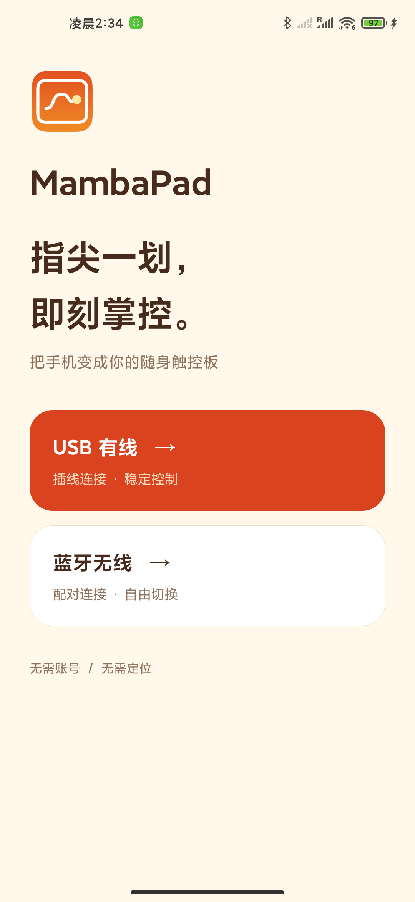

# MambaPad

**指尖一划，即刻掌控。** 把 Android 手机变成 Windows 电脑的触控板和键盘。

暖白、橙红与琥珀色的简洁界面，原生 Android 控件，无 WebView。当前版本：**1.2.0-preview**。

 

## 功能

- USB 有线模式，无需 Root；Windows 接收端 EXE 约 3.47 MiB。
- 单指移动、轻点和双击、长按拖动、双指滚动，以及左键、右键与滚轮按钮。
- 纯触控模式支持横竖屏，横屏扩大触控面积。
- 竖屏键盘模式使用手机当前系统输入法，触控板随键盘实际高度调整；功能栏提供 Ctrl、Alt、Win、Shift、方向键等。
- USB 支持手机输入法确认后的中文、英文和表情。
- 横屏键盘模式：左右分区按键，中间触控板。
- USB 和蓝牙从首页分别进入，两者均可返回首页；主页适配横屏。
- 不申请定位权限，不需要账号，不读取剪贴板。

## 使用

下载：[GitHub Releases](https://github.com/FFraankk/MambaPad/releases)。

需要 Android 9 或更新版本；当前实测设备为小米 10 / Android 11，电脑为 Windows x64。

1. 从 Releases 下载并安装 Android 预览包中的 APK。
2. 下载并解压 Windows x64 包，保留 `tools/adb`、许可证文件与 EXE 的目录结构。
3. 运行 `MambaPad.exe`，用支持数据传输的 USB 线连接手机。
4. 在手机开启 USB 调试，并确认对电脑的调试授权。部分电脑可能需要手机厂商的 ADB 驱动。
5. 在 MambaPad 首页进入 **USB 有线**，等待连接成功。
6. 点击 **键盘** 切换输入模式；竖屏点击输入框打开手机输入法，功能栏可横向滑动，点击 **收起** 隐藏键盘。

电脑端无需安装 .NET、Java 或后台服务。使用期间需保持接收端运行；关闭窗口或 Ctrl+C 退出。多设备时可运行 `MambaPad.exe -serial 设备序列号`。

## 当前限制

- 开发预览版，APK 使用 debug 签名，Windows EXE 未做代码签名。
- 蓝牙使用标准 HID，实际配对和输入兼容性仍待进一步验证。手机选好的汉字无法通过 HID 直接传送；蓝牙中文需使用电脑输入法。
- USB 文字功能需要配套本版本 EXE，旧接收端会提示更新。
- Windows 普通权限输入受 UIPI 限制，不能保证控制管理员窗口、UAC 或登录界面。
- 系统输入法为悬浮键盘时，覆盖区域由输入法自身管理。不同手机和输入法尚未逐一验证。

## 开发与验证

源码位于 `app/` 和 `windows-receiver/`，构建步骤见 [BUILDING.md](BUILDING.md)。

已通过 Android JVM 单测 15 项、Go 单测与 vet；真机回归覆盖手势、四种控制布局、页面返回、输入法组合/提交和高度适配。用户已确认中文、英文、回车、退格与主页横屏正常。完整 Android lint 尚有 41 个旧代码错误，未屏蔽或添加 baseline。

参考：[输入协议](docs/protocol-v1.md)、[验证记录](docs/shared-controls-1.2.md)。

## 开源许可

MambaPad 基于 [KeysJoy](https://github.com/iFeel-is-a-mouse/KeysJoy) 修改；KeysJoy 源自 Dima Rostopira 的 [Kontroller](https://github.com/rostopira/kontroller)。沿用代码按 Apache License 2.0 使用和分发，保留原有版权与许可证声明。

完整许可证见 [LICENSE](LICENSE)，来源与修改说明见 [NOTICE.txt](NOTICE.txt)，[上游 README](docs/upstream-README.md) 保留用于溯源。MambaPad 增加 USB 传输、Windows 接收端、共享控制界面、系统输入法支持及原创图标。Go 和 ADB 等第三方组件的许可随对应发布包保留。
